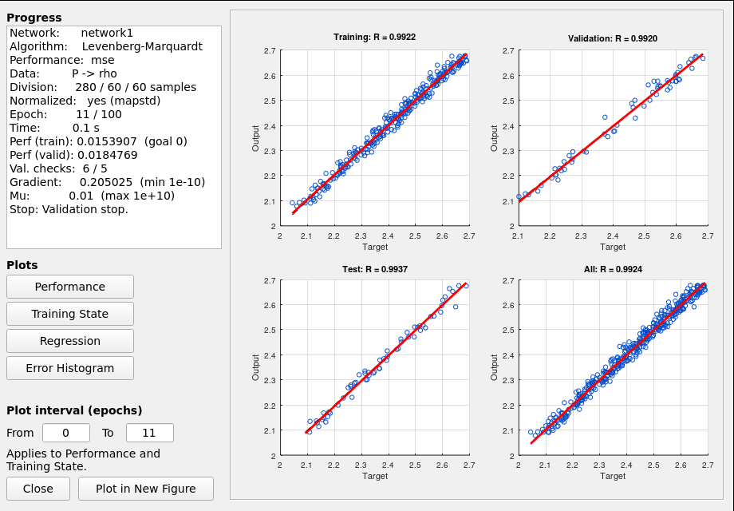
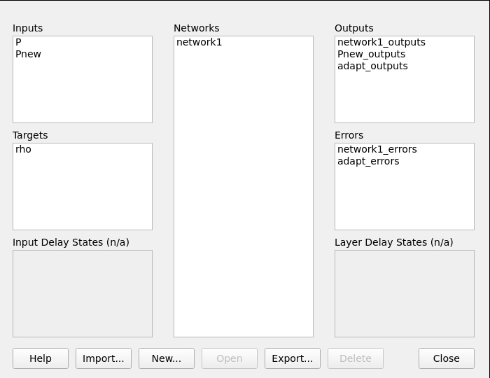
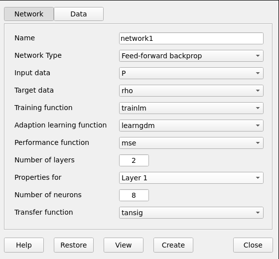
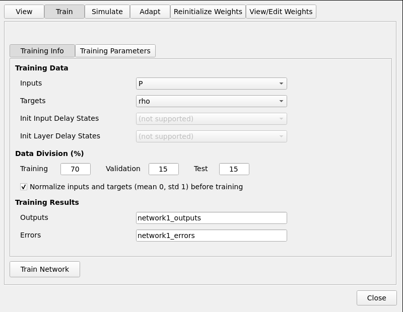
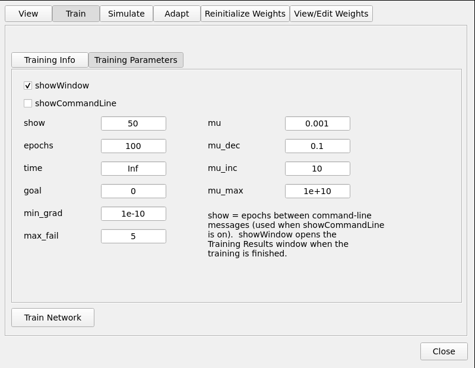
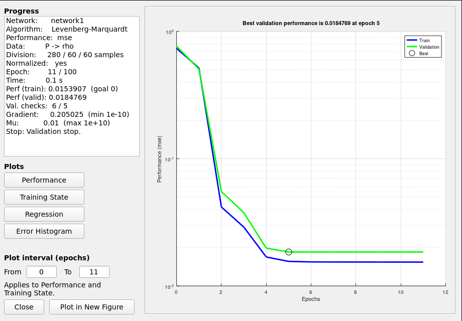
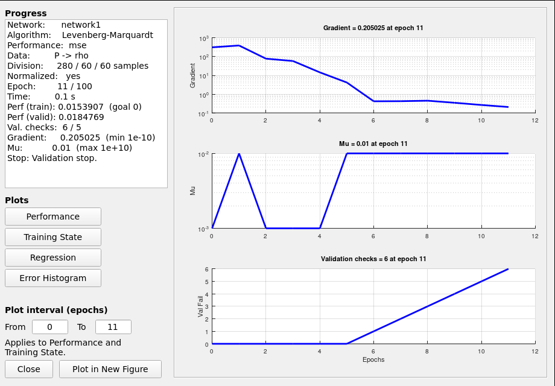
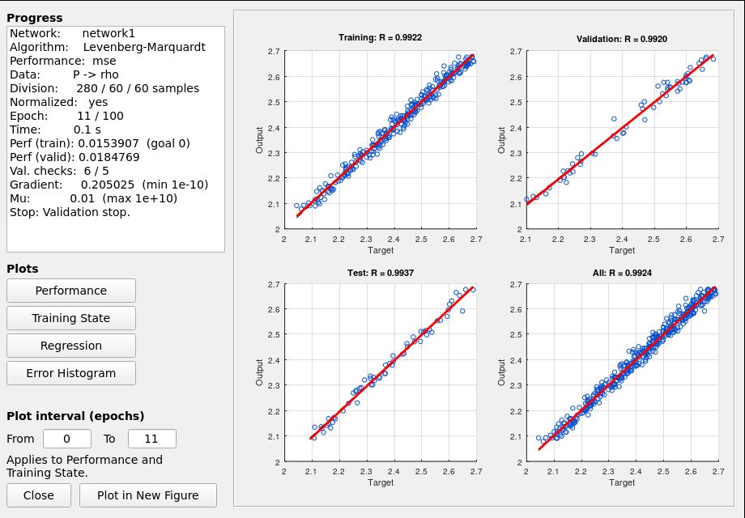
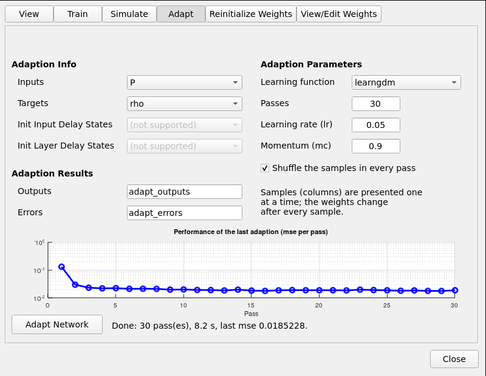

# octave-nnet-gui

A neural-network toolbox for GNU Octave with a graphical **Network/Data Manager** (`nntool`), modelled on the MATLAB tool of the same name. It is the Octave `nnet` package extended with a GUI, online learning (`adapt`), a training record from `train`, and several bug fixes. It runs on **Windows and Linux**.



## Features

- **`nntool`**: import or create data, build feed-forward networks, train, simulate, adapt, inspect and edit weights, and export results, all from windows (Qt toolkit).
- **Quality-control plots**: performance, training state, regression and error histogram, with a plot interval, and a button that redraws any plot in a normal figure so you can save it as PNG.
- **`[net, tr] = train(...)`**: `train` now returns a training record (performance, validation performance, gradient, `mu`, stop reason, time).
- **Automatic scaling of mixed-scale data, inside the network**: `newff(..., "normalize")` makes the network scale every input and target variable by itself (from the training samples), so you train and simulate with the **raw data** and get results in the original units. Attributes such as acoustic impedance (thousands), instantaneous phase (±π), envelope and frequency need no hand-picked divisors like `AI/400`. In `nntool` the *Normalize* option is ticked by default. See [Variables on very different scales](#variables-on-very-different-scales).
- **`adapt`, `learngd`, `learngdm`**: online (sample-by-sample) learning with gradient descent, with or without momentum.
- **Examples**: five ready-to-run functions: a small rock-physics data set (P-wave velocity to density and S-wave velocity) and a demonstration of data scaling.
- **Fixes to the original `nnet`**: a gradient bug for the `relu` transfer function, `min_max` for a single input row, and removal of warnings that newer Octave versions print. See [CHANGELOG below](#changelog).

What the toolbox does: multilayer feed-forward networks (2 to 10 layers) trained with Levenberg-Marquardt (`trainlm`) and the mean squared error. Other network types, delay states and time-series training are not included (see [Limitations](#limitations)).

## Requirements and tested versions

Pure Octave code, nothing to compile. `nntool` needs the **Qt graphics toolkit** and a graphical session; the command-line functions work anywhere.

| Octave | System | Tested |
|---|---|---|
| 6.4.0 | Linux | install, all unit tests, examples, every `nntool` window |
| 7.1.0 | Linux | install, all unit tests, examples, every `nntool` window |
| 8.4.0 | Linux | install, all unit tests, examples, every `nntool` window |
| 11.3.0 | Windows | installation and basic use |

Other versions from 6.4.0 on are expected to work but have not been tested.

## Installation

Download the file for your system from the [latest release](../../releases/latest):

- Windows: `nnet_gui-1.0.1.zip`
- Linux: `nnet_gui-1.0.1.tar.gz`

(The "Source code" archives that GitHub generates for a release work as well.)

**Windows** (in the Octave window):

```
cd C:/path/to/the/download/folder
pkg uninstall nnet          % only if an older nnet is installed
pkg install nnet_gui-1.0.1.zip
pkg load nnet
```

**Linux**:

```
cd ~/Downloads
pkg uninstall nnet          % only if an older nnet is installed
pkg install nnet_gui-1.0.1.tar.gz
pkg load nnet
```

No administrator rights are needed. `pkg load nnet` must be repeated **in every Octave session**; if Octave says `'nntool' undefined`, the package has not been loaded.

Directly from GitHub, without downloading anything first:

```
pkg install "https://github.com/vandanue/octave-nnet-gui/archive/refs/tags/v1.0.1.tar.gz"
```

Check the installation:

```
pkg load nnet
nnet_demo_cli(false)        % prints the training result and a test error
```

During installation Octave may print `Invalid UTF-8 byte sequences have been replaced`; this only concerns the help-text index and is harmless.

### Notes for Linux

- Start Octave with `octave --gui`, or `octave --no-gui` from a terminal on the desktop. In a terminal without a display (plain SSH, `octave-cli`) `nntool` cannot open and stops with a message that says so; use `ssh -X` or the command-line examples.
- `available_graphics_toolkits()` must list `qt`. If Octave uses the older `fltk` toolkit, `nntool` switches to `qt` by itself (with `fltk` the windows would be blank).
- Saving plots as PDF or EPS needs Ghostscript (`sudo apt install ghostscript`). PNG works without it.

## Quick start

### Graphical tool

```
pkg load nnet
nnet_demo_nntool
```

This creates the example data in the workspace (`P`, `T`, `Pnew`) and opens the Network/Data Manager. Then:

1. **Import...** `P` as *Input Data*, `T` as *Target Data*, `Pnew` as *Input Data*.
2. **New...** choose input `P`, target `T`, 8 neurons in layer 1, press **Create**.
3. Select the network, press **Open**. On the **Train** tab tick *Normalize inputs and targets* and press **Train Network**.
4. Look at the plots in the Training Results window.
5. On the **Simulate** tab choose `Pnew` and press **Simulate Network**. **Export...** the result to the workspace.

A step-by-step version with the expected numbers is in the [user guide](docs/USER_GUIDE.md#6-worked-example-in-the-graphical-tool).

### Command line

```
pkg load nnet
[Vp, rho, Vs] = nnet_demo_data(400, 1);
P = Vp;  T = [rho; Vs];                      % rows = variables, columns = samples

[Ptr, Pva, Pte, itr, iva, ite] = dividerand(P, 70, 15, 15);
[Ptrn, meanp, stdp, Ttrn, meant, stdt] = prestd(Ptr, T(:,itr));

net = newff(min_max(P), [8 2], {"tansig","purelin"}, "trainlm", "learngdm", "mse");
net.trainParam.show = NaN;
VV.P = trastd(Pva, meanp, stdp);  VV.T = trastd(T(:,iva), meant, stdt);
[net, tr] = train(net, Ptrn, Ttrn, [], [], VV);   % tr = training record

Y = poststd(sim(net, trastd(Pte, meanp, stdp)), meant, stdt);
```

`nnet_demo_cli` is the complete version of this example, and `nnet_demo_adapt` shows online learning with `adapt`.

### Variables on very different scales

Inputs such as acoustic impedance (thousands), instantaneous phase (−π to π), amplitude envelope (0 to 5) and instantaneous frequency (tens of Hz) must be brought to a comparable range, or a network with `tansig` neurons trains badly (typically it stops after a few epochs with *Maximum MU reached* and learns nothing). Do not choose divisors by hand: let the network scale every variable (every row) by itself. Add `"normalize"` to `newff`:

```
% P: 4 x N matrix (one row per attribute), T: 1 x N target; raw, unscaled data
net = newff(min_max(P), [10 1], {"tansig","purelin"}, "trainlm", "normalize");
net.trainParam.goal = 1e-3;                       % goal is in scaled units
net = train(net, Ptr, Ttr, [], [], struct("P", Pva, "T", Tva));
Y = sim(net, Pte);                                % already in the original units
```

The scaling (mean 0 and standard deviation 1 per row; `"mapminmax"` gives min-max to [−1, 1] like MATLAB) is computed from the training samples the first time `train` is called, stored in the network, and applied by `train`, `sim` and `adapt`. Apply a trained network to another data set (another well) with `sim(net, Pnew)`: the same scaling is used. Without the option nothing changes, so existing scripts give the same results as before. In `nntool`, the *Normalize inputs and targets* option on the Train tab does the same and is **ticked by default**.

The same can be done by hand with `prestd`, `trastd` and `poststd`. `nnet_demo_scaling` compares all options on synthetic attributes of exactly these sizes (test-set R², 1 = perfect):

| Preparation of the data | R² |
|---|---|
| none (raw values) | −0.05 (the network fails) |
| hand-picked divisors (`AI/400`, `envelope/5`) | 0.990 |
| automatic by hand, mean 0 and std 1 (`prestd`) | 0.989 |
| automatic by hand, min–max to [−1, 1] | 0.989 |
| **inside the network, `newff(..., "normalize")`** | **0.989** |

Notes: `tr.perf`, the goal and the validation performance are in scaled units. Instantaneous phase wraps around at ±π; if it matters, feed `cos(phase)` and `sin(phase)` instead of the raw phase.

## Screenshots

| | |
|---|---|
|  |  |
| Network/Data Manager | Creating a network |
|  |  |
| Train tab: data division, normalisation | Train tab: training parameters |
|  |  |
| Training Results: performance | Training Results: training state |
|  |  |
| Training Results: error histogram | Adapt tab (online learning) |

## Documentation

- **[User guide](docs/USER_GUIDE.md)**: installation, data conventions, every function and parameter, every window of `nntool`, a worked example, tips and troubleshooting.
- In Octave: `help nntool`, `help adapt`, `help newff`, and so on.
- The original package manual is in `doc/pdf/`.

## Limitations

- One network type: feed-forward backpropagation (`newff`), one input block and one output block (each may have several rows).
- Training function `trainlm` and performance function `mse` only.
- No input or layer delay states; `adapt` presents the columns of the input matrix one at a time (no cell-array time series).
- The Training Results window appears when training has finished; training cannot be stopped from it (use Ctrl+C in the command window).
- The manager keeps its items only while it is open: export to a MAT-file before closing.
- With several outputs of very different size, the regression plot and histogram mix all outputs together.

## Changelog

### 1.0.1

- **`newff(..., "normalize")`** (also `"mapstd"`, `"mapminmax"`, `"none"`): the network scales its inputs and targets by itself; `train`, `sim` and `adapt` then work with the raw data and return results in the original units. Opt-in on the command line: scripts that do not use it behave exactly as before. The keyword may be given in place of the fifth or sixth argument, e.g. `newff(Pr, [8 1], {"tansig","purelin"}, "trainlm", "normalize")`.
- **`nntool`:** *Normalize inputs and targets* is ticked by default and has a method choice (mean/std or min-max). It now uses the network's own scaling, so Simulate and Adapt work like the command line. Networks trained with 1.0.0 are upgraded automatically when imported or opened.
- `nnet_demo_scaling` also shows the in-network option.

### 1.0.0

Changes compared with the original `nnet` 0.1.13 (Octave Forge, with the relu/leakyrelu patch):

- **New:** `nntool` (and `__nntool_*` helpers), `adapt`, `learngd`, `learngdm`, `nnet_demo_data`, `nnet_demo_cli`, `nnet_demo_adapt`, `nnet_demo_nntool`, `nnet_demo_scaling`.
- **Scaling in `nntool`:** the *Normalize inputs and targets* option (mean 0, std 1 per variable, from the training samples).
- **`train` / `__trainlm`:** `[net, tr] = train(...)` returns the training record. `net = train(...)` works as before.
- **`__drelu` (bug fix):** the derivative of `relu` was always 1 in the Jacobian used by `trainlm`, so `relu` behaved like a linear function while training. A finite-difference check now agrees to about 1e-10. Networks with `relu` trained with older versions should be trained again.
- **`min_max`:** accepts a single row (one input variable).
- **`newff`:** the fifth argument selects the learning function for `adapt` (`"learngd"` or `"learngdm"`, default `"learngdm"`); the stray printout `notUsed = noSense` is gone.
- **Warnings:** single-character logical operators in 17 `if` conditions replaced by `||` and `&&` (no more "Matlab-style short-circuit" warnings); deprecated backslash line continuations in 29 test lines replaced by `...`.

All unit tests of the package pass (`test adapt`, `test min_max`, and so on).

## Running the tests

```
pkg load nnet
test adapt
test learngd
test learngdm
test min_max
test nnet_demo_cli
```

## Credits and licence

`nnet` was written by Michael Schmid for Octave Forge (<http://octnnettb.sourceforge.net>). The `nntool` interface, `adapt`, `learngd`, `learngdm`, the examples and the fixes listed above were added in this repository.

Licensed under the **GNU General Public License, version 2 or (at your option) any later version**, as the original package; see [COPYING](COPYING). MATLAB and `nntool` are trademarks of The MathWorks, Inc.; this project is not affiliated with or endorsed by them.
