# User guide: nnet with nntool for Octave

Version 1.0.1. Tested on Octave 6.4.0, 7.1.0 and 8.4.0 (Linux); installation confirmed on Octave 11.3.0 (Windows).

## Contents

1. [What this package is](#1-what-this-package-is)
2. [Installation](#2-installation)
3. [Basic concepts](#3-basic-concepts)
4. [Command-line workflow](#4-command-line-workflow)
5. [The graphical tool: nntool](#5-the-graphical-tool-nntool)
6. [Worked example in the graphical tool](#6-worked-example-in-the-graphical-tool)
7. [Practical advice](#7-practical-advice)
8. [Differences from the MATLAB nntool, and limitations](#8-differences-from-the-matlab-nntool-and-limitations)
9. [Troubleshooting](#9-troubleshooting)
10. [Changes made to the original nnet package](#10-changes-made-to-the-original-nnet-package)
11. [Quick reference](#11-quick-reference-of-the-new-and-changed-functions)

## 1. What this package is

This is the Octave `nnet` package (0.1.13 with the relu/leakyrelu patch) extended with:

- **`nntool`**: a graphical *Network/Data Manager* modelled on the MATLAB tool of the same name. You import or create data, build feed-forward networks, train and simulate them, look at quality-control plots, and export the results.
- **Automatic data scaling inside the network**: `newff(..., "normalize")` (section 3.4).
- **`[net, tr] = train(...)`**: `train` also returns a training record `tr` (performance, gradient, mu and validation history per epoch).
- **`adapt`, `learngd`, `learngdm`**: online (sample-by-sample) learning.
- **Five example functions** (`nnet_demo_data`, `nnet_demo_cli`, `nnet_demo_adapt`, `nnet_demo_nntool`, `nnet_demo_scaling`) that use small synthetic rock-physics data sets.
- **Fixes** to the original package (section 10), among them a gradient bug for the `relu` transfer function.

The package trains multilayer feed-forward networks (2 to 10 layers) with Levenberg-Marquardt (`trainlm`) and the mean squared error (`mse`). What it cannot do is listed in section 8.

## 2. Installation

The package is pure Octave code (nothing to compile).

**Windows**

```
cd C:/path/to/the/download/folder
pkg uninstall nnet          % only if an older nnet is installed
pkg install nnet_gui-1.0.1.zip
pkg load nnet
```

**Linux**

```
cd ~/Downloads
pkg uninstall nnet          % only if an older nnet is installed
pkg install nnet_gui-1.0.1.tar.gz     % the .zip works as well
pkg load nnet
```

**In every Octave session** load the package before using it:

```
pkg load nnet
```

If you type `nntool` or `newff` and Octave answers *undefined*, the package has not been loaded in this session.

Check the installation:

```
nnet_demo_cli(false)
```

It prints the number of training epochs and a test error for density and S-wave velocity (about 0.02 g/cm³ and 45 m/s).

During installation Octave may print `Invalid UTF-8 byte sequences have been replaced`. This only concerns the help-text index and is harmless.

### 2.1 Linux notes

- The installation is for your user and needs no sudo. Use forward slashes in paths, for example `~/data/P.mat`.
- **nntool needs a graphical session and the Qt toolkit.** Start Octave with `octave --gui`, or `octave --no-gui` from a terminal on the desktop, and check `available_graphics_toolkits()`: it must list `qt`. In a terminal without a display (a plain SSH login, or `octave-cli`) nntool stops with a message that says so; use `ssh -X` or run the command-line examples instead.
- If Octave uses the older `fltk` toolkit, nntool switches to `qt` by itself. With `fltk` the windows would be blank, because that toolkit cannot draw the controls.
- Saving plots as PDF or EPS needs Ghostscript (Debian or Ubuntu: `sudo apt install ghostscript`). PNG output works without it.
- If the text in a window looks too small or too large, that is the Qt font scaling of your desktop; the layout uses fixed sizes.

## 3. Basic concepts

### 3.1 Data layout

Everything follows one convention: **rows are variables, columns are samples.**

| Name | Size | Meaning |
|---|---|---|
| `P` (inputs) | R × Q | R input variables, Q samples |
| `T` (targets) | S × Q | S output variables, Q samples |
| `Y` (outputs) | S × Q | what the network predicts for `P` |
| `E` (errors) | S × Q | `T − Y` |

A single input variable is a **row vector** (1 × Q), for example a list of P-wave velocities. A single sample is a column.

### 3.2 Network type

Only one kind of network exists: the static, fully connected **feed-forward network with backpropagation** created by `newff`. It has one input block and one output block. The last layer is the output layer; all other layers are hidden layers.

### 3.3 Transfer functions

`tansig` (hyperbolic tangent, the usual choice for hidden layers), `logsig`, `purelin` (linear, the usual choice for the output layer), `relu`, `leakyrelu`, `leakybin`.

### 3.4 Why normalise

Transfer functions such as `tansig` saturate for large inputs. If one variable is in the thousands (acoustic impedance, velocity in m/s) and another is about 2 (density in g/cm³) or between −π and π (instantaneous phase), the network trains badly or not at all.

**Do not choose divisors by hand** (`AI/400`, `envelope/5`): the choice is arbitrary, and different people would pick different numbers (and a divisor that works for one data set fails on the next). Let the network scale every variable (every row) automatically from the training samples. There are three equivalent ways:

1. **Inside the network (recommended).** Add `"normalize"` to `newff`. You then train and simulate with the **raw data** and `sim` returns results in the original units:

   ```
   net = newff(min_max(P), [10 1], {"tansig","purelin"}, "trainlm", "normalize");
   net = train(net, Ptr, Ttr, [], [], struct("P", Pva, "T", Tva));
   Y   = sim(net, Pnew);       % the scaling of the training data is applied automatically
   ```

   The keyword is `"normalize"` (same as `"mapstd"`: mean 0 and standard deviation 1 for every row) or `"mapminmax"` (every row mapped to [−1, 1], MATLAB's default). It may be given as the seventh argument of `newff` or in place of the fifth or sixth (`blf`, `pf`). The scaling is computed from the training samples the first time `train` (or `adapt`) is called, stored in `net.normalization`, and **kept** for later calls and for other data sets. To compute it again, set `net.normalization.settings = []`. Without the keyword nothing changes, so existing scripts give the same results as before.
2. **In `nntool`**, the *Normalize inputs and targets* option of the Train tab does the same, with a choice of the method. It is **ticked by default** and recomputed from the training samples of each training run.
3. **By hand**, with `prestd` (scale), `trastd` (apply the same scaling to other data) and `poststd` (convert the outputs back); example 4.4 shows it.

`nnet_demo_scaling` compares the options on four synthetic attributes of very different size (acoustic impedance 4000 to 8000, instantaneous phase −π to π, envelope 0 to 5, instantaneous frequency 10 to 70 Hz). The test-set R² (1 = perfect) is:

| Preparation of the data | R² |
|---|---|
| none (raw values) | −0.05 (the network fails) |
| hand-picked divisors (`AI/400`, `envelope/5`) | 0.990 |
| automatic by hand, mean 0 and std 1 (`prestd`) | 0.989 |
| automatic by hand, min–max to [−1, 1] | 0.989 |
| **inside the network, `newff(..., "normalize")`** | **0.989** |

So the automatic scaling is as good as well-chosen manual divisors, without any subjective choice. A mild difference, such as dividing one variable by 5, usually changes little; the trouble starts when variables differ by factors of hundreds or thousands (typically `trainlm` then stops after a few epochs with *Maximum MU reached* and the network learns nothing).

Notes. (1) With scaling, `tr.perf`, `tr.vperf` and the `goal` are in scaled units: a goal of 1e-4 then means an error of 1 % of the standard deviation, which for noisy data is usually far too strict; use around 1e-2 to 1e-3. (2) Instantaneous phase wraps around at ±π, so +3.1 and −3.1 are almost the same angle although they look far apart; scaling does not change that. If the phase matters, use `cos(phase)` and `sin(phase)` as inputs instead.

Always evaluate the network on samples it was **not** trained on (the test set, or a well that was left out), not only on the training data: a network with many neurons can reproduce the training data closely and still predict poorly elsewhere.

## 4. Command-line workflow

### 4.1 The functions

| Function | Purpose |
|---|---|
| `net = newff(Pr, ss, tf, "trainlm", blf, "mse", "normalize")` | create the network; the last argument (optional) makes it scale its data by itself |
| `[net, tr] = train(net, P, T, [], [], VV)` | train (batch, Levenberg-Marquardt); `VV` is optional |
| `Y = sim(net, P)` | simulate |
| `[net, Y, E, tr] = adapt(net, P, T, passes)` | online learning |
| `Pr = min_max(P)` | R × 2 matrix of minimum and maximum of each input row |
| `[Ptr,Pva,Pte,itr,iva,ite] = dividerand(P,a,b,c)` | random division into training, validation and test samples (percentages a, b, c) |
| `[Pn,meanp,stdp,Tn,meant,stdt] = prestd(P,T)` | normalise inputs and targets |
| `Pn = trastd(P, meanp, stdp)` | apply the same normalisation to new data |
| `Y = poststd(Yn, meant, stdt)` | undo the normalisation of the outputs |
| `saveMLPStruct(net, file)` | write the network to a text file |

`newff` arguments:

- `Pr`: R × 2 matrix of input ranges, normally `min_max(P)`.
- `ss`: row vector of layer sizes, for example `[8 2]` means 8 hidden neurons and 2 output neurons. The last number must equal the number of rows of the targets.
- `tf`: cell array of transfer functions, one per layer, for example `{"tansig","purelin"}`.
- `blf`: the learning function used by `adapt`: `"learngdm"` (default) or `"learngd"`. `train` does not use it.
- `nf` (seventh argument, optional): automatic scaling of inputs and targets: `"normalize"` (= `"mapstd"`), `"mapminmax"` or `"none"` (default). See section 3.4.

### 4.2 Training parameters

They are fields of `net.trainParam`:

| Field | Default | Meaning |
|---|---|---|
| `epochs` | 100 | maximum number of epochs |
| `time` | Inf | maximum training time in seconds |
| `goal` | 0 | stop when the performance (mse) reaches this value |
| `min_grad` | 1e-10 | stop when the gradient becomes smaller than this |
| `max_fail` | 5 | maximum number of validation checks (consecutive epochs without improvement of the validation performance) |
| `mu` | 0.001 | initial Levenberg-Marquardt parameter |
| `mu_dec` | 0.1 | factor that decreases `mu` after a successful step |
| `mu_inc` | 10 | factor that increases `mu` after a failed step |
| `mu_max` | 1e10 | stop when `mu` exceeds this value |
| `show` | 50 | epochs between messages on the command line (use `NaN` for none) |

### 4.3 The training record `tr`

`[net, tr] = train(...)` returns a struct. The per-epoch vectors start with epoch 0 (the untrained network).

| Field | Content |
|---|---|
| `tr.epoch` | `0:last_epoch` |
| `tr.perf` | performance of the training set |
| `tr.vperf`, `tr.numFail` | validation performance and number of validation checks (only if `VV` was given) |
| `tr.mu`, `tr.gradient` | `mu` and gradient norm |
| `tr.stop` | the reason for stopping |
| `tr.time` | elapsed time in seconds |

Possible stop messages: *Performance goal met.* / *Maximum epoch reached, performance goal was not met.* / *Maximum time elapsed, performance goal was not met.* / *Minimum gradient reached, performance goal was not met.* / *Maximum MU reached, performance goal was not met.* / *Validation stop.*

When validation is used, `train` returns the network of the epoch with the best validation performance, not the last one. If the network scales its data (`newff` option `"normalize"`), the performance values in `tr` and the training goal are in scaled units.

### 4.4 Example 1: train with validation (`nnet_demo_cli`)

The task: predict density (g/cm³) and S-wave velocity (m/s) from the P-wave velocity (m/s). The data come from `nnet_demo_data`, which generates synthetic values from Gardner's relation and Castagna's mudrock line plus noise. They only serve as an example.

```
pkg load nnet
[Vp, rho, Vs] = nnet_demo_data(400, 1);
P = Vp;                 % 1 x 400  (one input)
T = [rho; Vs];          % 2 x 400  (two targets)

% 1. random division: 70 % training, 15 % validation, 15 % test
[Ptr, Pva, Pte, itr, iva, ite] = dividerand(P, 70, 15, 15);
Ttr = T(:,itr);  Tva = T(:,iva);  Tte = T(:,ite);

% 2. normalise with the statistics of the training set only
[Ptrn, meanp, stdp, Ttrn, meant, stdt] = prestd(Ptr, Ttr);
Pvan = trastd(Pva, meanp, stdp);
Tvan = trastd(Tva, meant, stdt);

% 3. network: 1 input, 8 tansig neurons, 2 linear outputs
net = newff(min_max(P), [8 2], {"tansig","purelin"}, "trainlm", "learngdm", "mse");
net.trainParam.epochs = 100;
net.trainParam.show = NaN;            % no messages while training

% 4. train, with the validation set for early stopping
VV.P = Pvan;  VV.T = Tvan;
[net, tr] = train(net, Ptrn, Ttrn, [], [], VV);
printf("Stopped after %d epochs: %s\n", tr.epoch(end), tr.stop);

% 5. simulate the test set and go back to the original units
Yn = sim(net, trastd(Pte, meanp, stdp));
Y  = poststd(Yn, meant, stdt);
printf("Test RMSE: density %.4f, Vs %.1f\n", ...
       sqrt(mean((Y(1,:)-Tte(1,:)).^2)), sqrt(mean((Y(2,:)-Tte(2,:)).^2)));

% 6. look at the training
figure; semilogy(tr.epoch, tr.perf, tr.epoch, tr.vperf);
legend("Train", "Validation"); xlabel("Epoch"); ylabel("mse (normalised)");
```

A typical result is *Stopped after 13 epochs: Validation stop.* and a test error of about 0.022 g/cm³ and 46 m/s. This is close to the noise that was added to the data (0.02 g/cm³ and 40 m/s), so the network fits as well as the data allow. The random division changes the exact numbers from run to run. The whole example is available as `nnet_demo_cli`.

### 4.5 Example 2: online learning with `adapt` (`nnet_demo_adapt`)

`train` changes the weights once per epoch using all samples. `adapt` presents the samples **one at a time** and changes the weights after every sample (incremental or pattern learning). It is slower, but it can follow a data stream.

```
[Vp, rho] = nnet_demo_data(300, 2);
[Pn, meanp, stdp, Tn, meant, stdt] = prestd(Vp, rho);

net = newff(min_max(Pn), [6 1], {"tansig","purelin"}, "trainlm", "learngdm", "mse");
net.adaptParam.passes  = 40;     % passes through the 300 samples
net.adaptParam.lr      = 0.05;   % learning rate
net.adaptParam.mc      = 0.9;    % momentum (learngdm only)
net.adaptParam.shuffle = true;   % new random order in every pass

[net, Y, E, tr] = adapt(net, Pn, Tn);
semilogy(tr.pass, tr.perf, "b-o"); xlabel("Pass"); ylabel("mse (normalised)");
```

Points to know:

- `Y` and `E` are the outputs and errors of the **last pass**, measured while the network was still changing, and always returned in the original sample order.
- `tr.perf(k)` is the mean squared error of pass k.
- The error measure per sample is ½·Σe²; the learning function turns its gradient into the weight change. `learngd` is plain gradient descent, `learngdm` adds momentum.
- **If your samples are sorted** (for example by depth or velocity), set `shuffle = true`. Without it, learning with momentum can fail because the weights are pushed in one direction for a long time.
- If the weights diverge, `adapt` stops with a message; use a smaller learning rate.
- Delay states and cell-array (time-series) input are not supported: the columns of `P` are simply the samples, in order.

## 5. The graphical tool: nntool

### 5.1 Opening and closing

```
pkg load nnet
nntool            % open the Network/Data Manager
nntool("close")   % close it and all its windows
```

Calling `nntool` again while it is open just brings it to the front. The manager keeps its items **only while it is open**. Export what you need before closing (section 5.4).

### 5.2 The Network/Data Manager

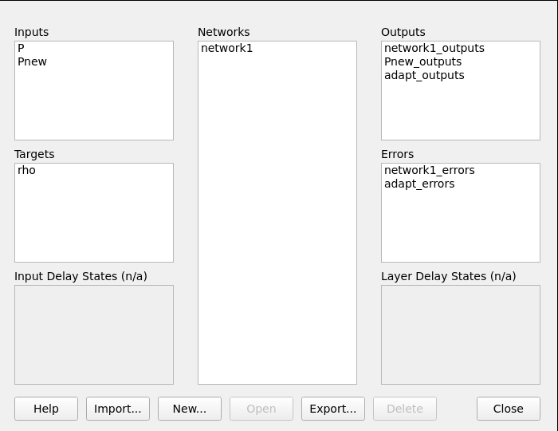

The window shows five lists: **Inputs**, **Targets**, **Networks**, **Outputs**, **Errors**. The *Input Delay States* and *Layer Delay States* lists are greyed out and marked *(n/a)* because this nnet has no delay states.

| Button | What it does |
|---|---|
| **Import...** | bring a variable from the workspace or a MAT-file into the manager |
| **New...** | create data or a network |
| **Open** | open the selected item (a network opens the Network window, data opens in a table) |
| **Export...** | send items to the workspace or to a MAT-file |
| **Delete** | remove the selected item from the manager |
| **Help**, **Close** | short help; close the manager and all windows |

Click an item to select it; selecting in one list clears the selection in the others. **Open** and **Delete** are enabled only when an item is selected. Names must be valid variable names (letters, digits, underscore, not starting with a digit) and are unique within a list. If a window is open for a network that you delete, that window closes by itself.

### 5.3 Import

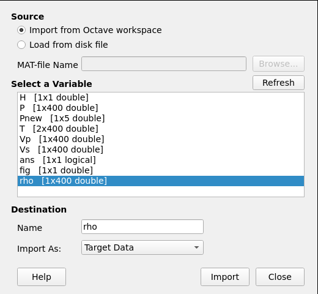

1. **Source**: *Import from Octave workspace* (default) or *Load from disk file*. For a file, type the path in *MAT-file Name* or press **Browse...**.
2. **Select a Variable**: the list shows each variable with its size and class. Press **Refresh** if you created a variable after opening the window.
3. **Destination**: type a *Name* (it is filled in with the variable name) and choose **Import As**: *Network*, *Input Data*, *Target Data*, *Output Data* or *Error Data*.
4. Press **Import**. The window stays open so you can import more variables.

Checks: data must be a real, non-empty, 2-D numeric matrix (rows = variables, columns = samples). A network must be a structure created by `newff`. If the name already exists in that list, you get an error message and nothing changes.

### 5.4 Export

Select one or more items (Ctrl or Shift for several), choose the destination, and press **Export**:

- *Export to Octave workspace*: each item becomes a variable with its manager name.
- *Save to disk file (MAT-file)*: a file dialog asks for the name; the file is saved in MAT-file format (v7).

If two selected items have the same name (for example an input and a target both called `x`), only the first is exported and a warning tells you which was skipped.

To keep your whole session, select all items and export them to a MAT-file. Later, import them again from that file.

### 5.5 New: create a network or data

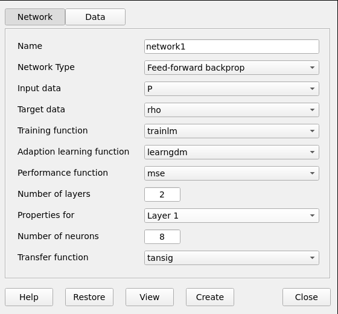

The *Create Network or Data* window has two tabs.

**Network tab**

| Field | Meaning |
|---|---|
| Name | name of the network (default `network1`, `network2`, ...) |
| Network Type | *Feed-forward backprop* (the only type) |
| Input data / Target data | choose from the Inputs and Targets lists of the manager |
| Training function | `trainlm` |
| Adaption learning function | `learngdm` or `learngd`; used only by the Adapt tab |
| Performance function | `mse` |
| Number of layers | 2 to 10 (hidden layers + the output layer) |
| Properties for | pick the layer whose settings you want to change |
| Number of neurons | neurons of that layer; **the output layer is fixed** to the number of rows of the target data |
| Transfer function | `tansig`, `logsig`, `purelin`, `relu`, `leakyrelu`, `leakybin` |

Buttons: **View** draws the schematic diagram (input, layers with the shape of their transfer function, output) without creating anything; **Create** builds the network with `newff` and adds it to the manager; **Restore** resets the fields; **Help**; **Close**. By default a new network has 2 layers: 10 `tansig` neurons and a `purelin` output layer.

To create a network you need input and target data in the manager, with the same number of samples (columns). The input range is taken from the input data automatically.

**Data tab**

Type a *Name*, a *Value* and a *Data Type* (Inputs, Targets, Outputs, Errors), then press **Create**. The value is evaluated in the Octave workspace, so it can be a variable name or an expression such as `rand(2,100)` or `[1 2 3; 4 5 6]`.

### 5.6 The Network window

Select a network in the manager and press **Open**. The window has six tabs: **View**, **Train**, **Simulate**, **Adapt**, **Reinitialize Weights** and **View/Edit Weights**. There is one window per network. Everything you do (training, adaption, initialisation, weight edits) is written back to the network in the manager immediately, and the other windows update.

#### View tab

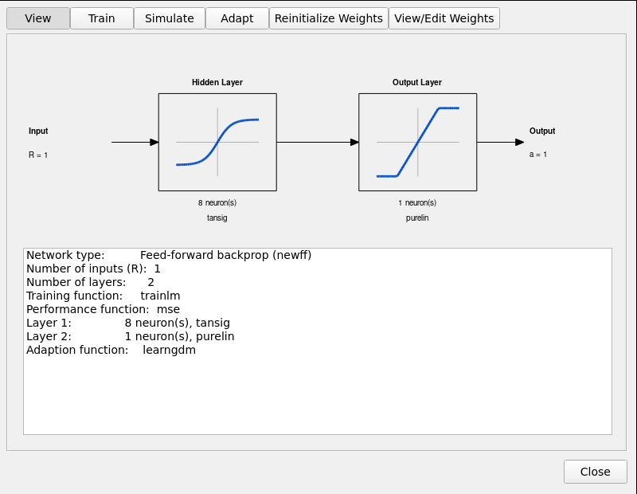

The schematic diagram of the network (input, hidden layers, output layer, each with its number of neurons and the shape of its transfer function) and a text summary: number of inputs, layers, training function, performance function, adaption function.

#### Train tab

The Train tab has two sub-tabs and a **Train Network** button. When you press the button, the tool checks that the data fit the network (number of input rows, number of output neurons, number of samples), divides the samples, normalises if requested, trains with `trainlm`, stores the trained network under the same name, and stores the outputs and errors for all samples in the original units, not only the training samples. A status line shows the number of epochs, the time and the reason for stopping.

**Training Info**

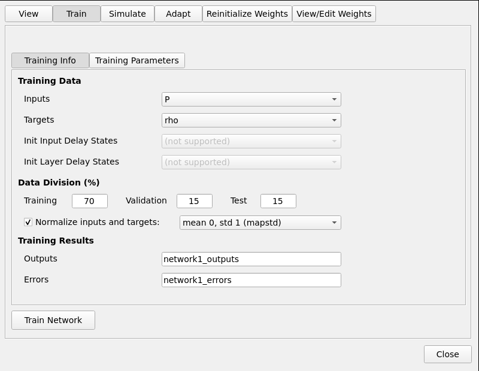

| Field | Meaning |
|---|---|
| Inputs, Targets | the data to train on, chosen from the manager |
| Init Input/Layer Delay States | greyed out (not supported) |
| Data Division (%) | *Training* (default 70), *Validation* (15) and *Test* (15). The samples are divided **at random, anew every time you train**. Training must be above 0. With Validation = 0 there is no early stopping. The test set is never used for training; it only appears in the plots. |
| Normalize inputs and targets | **ticked by default.** Inputs and targets are scaled by the network itself (section 3.4), using the **training samples only**, with the method of your choice: *mean 0, std 1 (mapstd)* or *min-max [-1, 1] (mapminmax)*. The scaling is stored in the network (`net.normalization`), so Simulate and Adapt use the same scaling and return results in the original units. It is recomputed at every training run. Untick it to train on the data as they are. |
| Outputs, Errors | names under which the results are stored in the manager (default: network name plus `_outputs` and `_errors`). An existing item of the same name is overwritten. |

**Training Parameters**

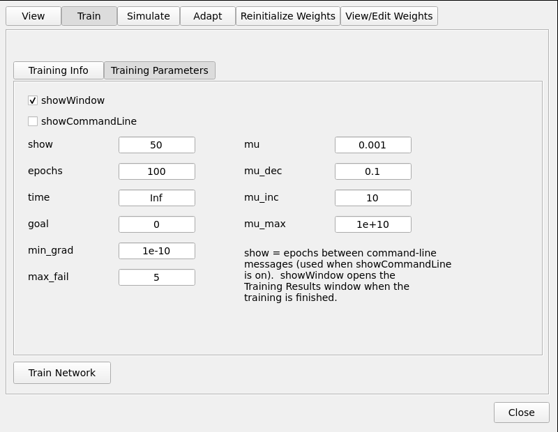

| Field | Default | Meaning |
|---|---|---|
| showWindow | on | open the Training Results window when training is finished |
| showCommandLine | off | print progress messages in the Octave command window |
| show | 50 | epochs between those messages |
| epochs | 100 | maximum number of epochs |
| time | Inf | maximum training time in seconds |
| goal | 0 | stop when the performance reaches this value |
| min_grad | 1e-10 | stop when the gradient falls below this |
| max_fail | 5 | maximum number of validation checks |
| mu, mu_dec, mu_inc, mu_max | 0.001, 0.1, 10, 1e10 | Levenberg-Marquardt parameter and how it is changed; training stops when `mu` exceeds `mu_max` |

Training runs in the foreground: the window does not respond until it finishes. For thousands of samples this can take a while, because Levenberg-Marquardt works with a matrix of (samples × outputs) rows and (number of weights) columns.

#### The Training Results window

It opens after training when *showWindow* is on, and shows:

- **Progress**: algorithm, data division, epochs, time, final performance, gradient, mu, validation checks and the stop message.
- **Performance**: mean squared error against epoch for the training and the validation set, a circle at the epoch of the best validation performance, and a dashed line for the goal (if above 0).
- **Training State**: gradient, mu and validation checks against epoch.
- **Regression**: output against target for the training, validation and test samples and for all samples, with the best straight line and the correlation coefficient R. The closer R is to 1, the better.
- **Error Histogram**: histogram (20 bins) of the errors T − Y for the three subsets.
- **Plot interval (epochs)**: *From* and *To* limit the epochs shown in the Performance and Training State plots (press Enter after editing).
- **Plot in New Figure**: redraws the current plot in an ordinary figure window that has the usual menu, so you can save or print it. From the command line, for example `print(gcf, "performance.png", "-dpng", "-r200")`.

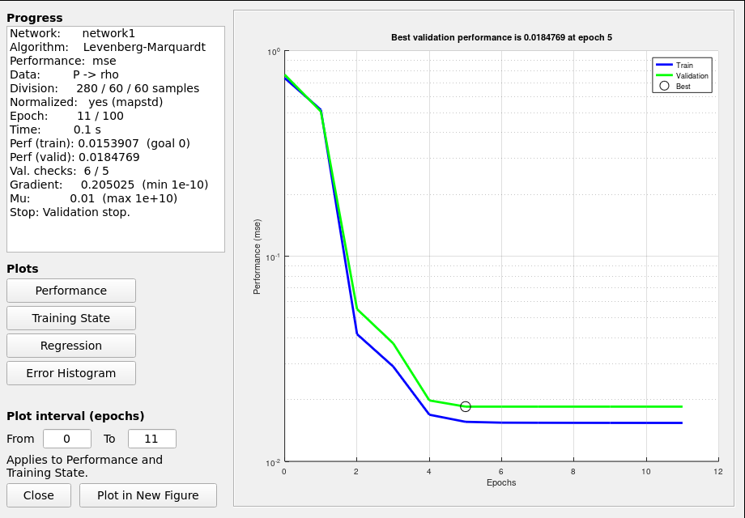

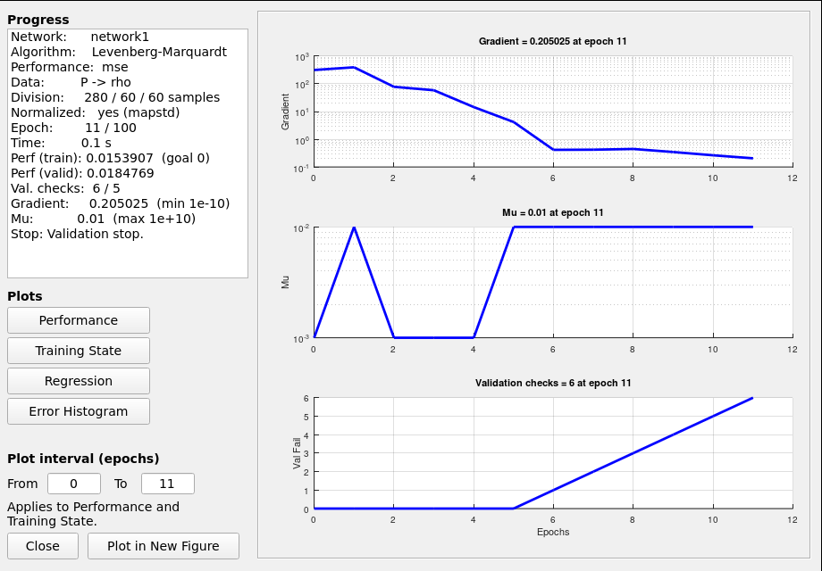

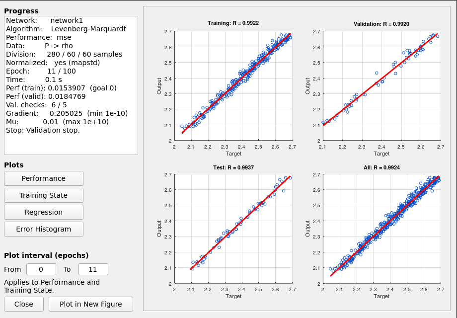

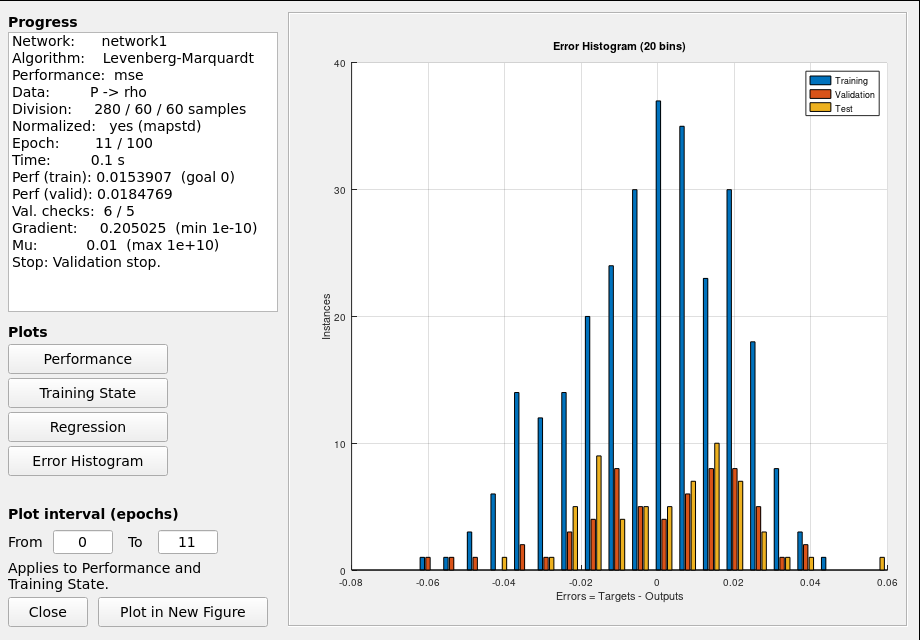

Two things to keep in mind. If you normalised, the performance values and curves are on the *normalised* scale, while the regression plot and the histogram are in the original units. With several outputs of very different size (such as density near 2 and velocity near 2000), the regression plot and histogram mix all outputs together and the large values dominate; check each output separately in the command window, as in example 4.4.

#### Simulate tab

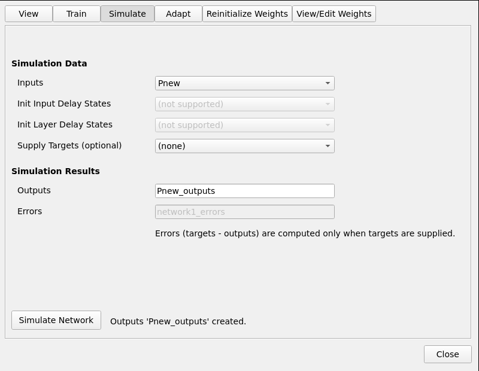

Choose the **Inputs** to simulate (they must have as many rows as the network has inputs), optionally **Targets** (then the errors T − Y are also computed), and the names for **Outputs** and **Errors**. Press **Simulate Network**. If the network was trained with *Normalize*, the inputs are scaled automatically and the outputs are returned in the original units.

#### Adapt tab

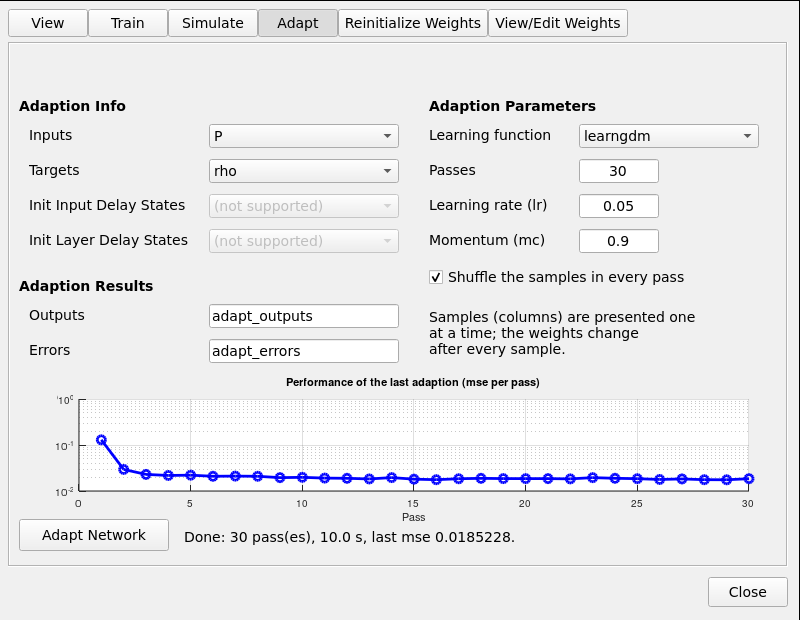

Online learning with `adapt` (section 4.5).

| Field | Meaning |
|---|---|
| Inputs, Targets | the samples to learn from, one column at a time |
| Learning function | `learngdm` (gradient descent with momentum) or `learngd` |
| Passes | number of passes through all samples |
| Learning rate (lr) | step size, default 0.01 (the plot below shows whether it is suitable) |
| Momentum (mc) | 0 ≤ mc < 1, only for `learngdm`, default 0.9 |
| Shuffle the samples in every pass | presents the samples in a new random order in each pass |
| Outputs, Errors | result names; they hold the outputs and errors of the last pass |

**Adapt Network** runs the adaption, updates the network, and plots the mean squared error of every pass. If the error explodes, the tool stops with a message: use a smaller learning rate. Networks created without a learning function can still be adapted: the tab gives them one. If the network was trained with *Normalize*, the same scaling is used here.

#### Reinitialize Weights tab

- The table shows the input ranges stored when the network was created (information only).
- **Initialize Weights** sets all weights and biases to random values in [−1, 1]. Use it to start training again from a different starting point; Levenberg-Marquardt can end in a poor local minimum.
- **Revert Weights** goes back to the values before the last initialisation (one level).

#### View/Edit Weights tab

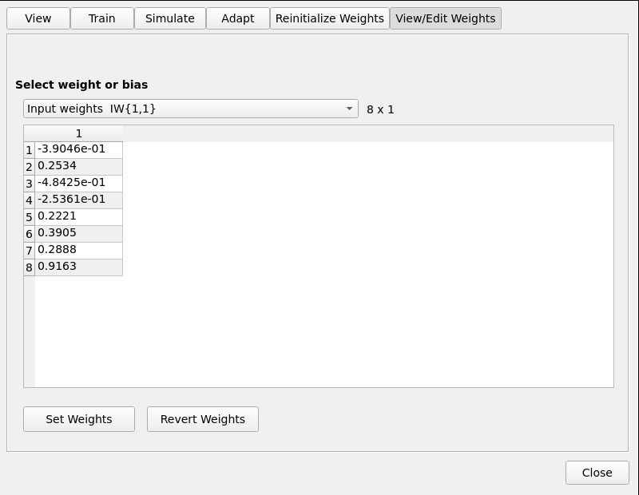

Choose a weight matrix or bias vector (`IW{1,1}`, `LW{2,1}`, `b{1}`, ...) from the list. Its values appear in a table. Edit cells and press **Set Weights** to write them into the network (the size must not change), or press **Revert Weights** to discard your edits and reload the values stored in the network.

## 6. Worked example in the graphical tool

This walks through the same task as example 4.4, but with the mouse. Time needed: about five minutes.

**Step 1: prepare the data and start the tool.**

```
pkg load nnet
nnet_demo_nntool
```

This creates `P` (1 × 400, P-wave velocity in m/s), `T` (2 × 400, density in g/cm³ and S-wave velocity in m/s) and `Pnew` (1 × 5, five velocities to predict), and opens the Network/Data Manager.

**Step 2: import.** Press **Import...**. In *Select a Variable* choose `P`, set *Import As* to *Input Data* and press **Import**. Choose `T`, set *Import As* to *Target Data*, press **Import**. Choose `Pnew`, *Input Data*, **Import**. Press **Close**. The lists now show `P` and `Pnew` under Inputs and `T` under Targets.

**Step 3: create the network.** Press **New...**. On the Network tab choose *Input data* `P` and *Target data* `T`. Leave *Number of layers* at 2. Under *Properties for* choose *Layer 1* and set *Number of neurons* to 8 (transfer function `tansig`). Layer 2 is the output layer: 2 neurons (fixed by the targets), `purelin`. Press **View** to see the diagram, then **Create** and **Close**. `network1` appears under Networks.

**Step 4: train.** Select `network1` and press **Open**. On the **Train** tab, *Training Info*, choose Inputs `P` and Targets `T`. **Tick *Normalize inputs and targets***: this matters here because velocity is in the thousands and density is about 2. Press **Train Network**. After a second the Training Results window opens. You should see about 10 to 30 epochs and the message *Validation stop.* Look at **Performance** (training and validation curves close together, no rise of the validation curve), **Regression** (points on the line, R close to 1) and **Error Histogram** (errors centred on 0).

**Step 5: simulate.** Back in the Network window open the **Simulate** tab. Choose Inputs `Pnew`, leave Targets empty, press **Simulate Network**. The result `network1_outputs` (2 × 5) appears in the manager.

**Step 6: look at the result and export.** In the manager select `network1_outputs` and press **Open** to see the table. Then press **Export...**, select `network1_outputs` and `network1`, choose *Export to Octave workspace* and press **Export**. In the command window:

```
network1_outputs
```

The first row is density, the second is S-wave velocity. For the five velocities 2500, 3000, 3500, 4000 and 4500 m/s the true values of the two relations used to generate the data are:

| Vp (m/s) | 2500 | 3000 | 3500 | 4000 | 4500 |
|---|---|---|---|---|---|
| density (g/cm³) | 2.192 | 2.294 | 2.384 | 2.465 | 2.539 |
| Vs (m/s) | 983 | 1414 | 1845 | 2276 | 2707 |

Your network should give values within about 0.01 g/cm³ and 10 m/s of these. One test run gave 2.187 / 2.291 / 2.385 / 2.462 / 2.531 g/cm³ and 984 / 1420 / 1853 / 2281 / 2715 m/s. The numbers differ a little every time, because the sample division and the starting weights are random.

**Step 7: try the other tabs.** On the **Adapt** tab, choose the same `P` and `T`, set *Passes* to 20 and *Learning rate* to 0.05, and press **Adapt Network**: the plot shows the error falling pass by pass. On **Reinitialize Weights** press **Initialize Weights** and train again to see how much the result depends on the starting weights. On **View/Edit Weights** look at `IW{1,1}`.

## 7. Practical advice

- **Normalise whenever the variables differ in size.** This is the most common reason for a network that does not learn.
- **Start small.** A few neurons (5 to 10) in one hidden layer are enough for many smooth problems. More neurons fit the training data more closely but may generalise worse.
- **Watch the validation curve.** If the training error keeps falling while the validation error rises, the network is over-fitting. *Validation stop.* is the safeguard working, not an error.
- **Judge the network on the test set**, not on the training samples. The Regression plot shows it directly.
- **Train more than once.** The result depends on the random starting weights and the random division. Use *Initialize Weights* and train again, and keep the best network.
- **Mind the size of the test set.** With few samples, 15 % may be a handful of points; use more data or a larger share, or repeat with a different division.
- **Save your work.** The manager forgets everything when closed. Export the networks and data to a MAT-file, and keep the scripts that created your data.
- **Reproducibility.** The division and the initial weights use Octave's random generator. To repeat a command-line run exactly, call `rand("seed", 1); randn("seed", 1);` before `dividerand` and `newff`.
- **relu** works with `trainlm` since version 1.0.0 (section 10). A `tansig` hidden layer with a `purelin` output layer remains the safe default.

## 8. Differences from the MATLAB nntool, and limitations

| MATLAB nntool | This package |
|---|---|
| several network types (cascade, Elman, radial basis, ...) | only feed-forward backprop (`newff`) |
| many training functions | only `trainlm` (Levenberg-Marquardt) |
| many performance functions | only `mse` |
| several inputs and outputs per network | one input block and one output block (each may have several rows) |
| input and layer delay states | not supported; those lists are shown greyed out |
| adapt with cell-array (time-series) data and many learning functions | `adapt` with `learngd` and `learngdm`, sample by sample; the columns are the samples |
| data division and normalisation are network properties | the division is chosen in the Train tab for each training run; the normalisation is stored in the network (`net.normalization`, `newff` option) |
| live training window with a Stop button | the Training Results window appears after training; training cannot be stopped from the window (use Ctrl+C in the command window) |
| nnstart apps (fitting, pattern recognition, clustering, time series) | not included |
| tabs | built from toggle buttons, because Octave has no tab control |
| manager contents | kept only while the manager is open; export before closing |

Other limits: the transfer functions are `tansig`, `logsig`, `purelin`, `relu`, `leakyrelu` and `leakybin`; the number of layers is 2 to 10; `trainlm` needs memory proportional to (samples × outputs) × (number of weights).

## 9. Troubleshooting

| Message or symptom | Cause and remedy |
|---|---|
| `'nntool' undefined` or `'newff' undefined` | run `pkg load nnet` (needed in every session) |
| *nntool: the Qt graphics toolkit is not available ...* | start Octave in a graphical session (section 2.1) |
| windows are blank (Linux) | the fltk toolkit is in use; `nntool` switches to qt by itself, or run `graphics_toolkit("qt")` first |
| *Input data and target data are needed* | create or import both before creating a network |
| *The network has N input(s) but 'X' has M row(s)* | the data are in the wrong orientation. Rows must be variables and columns samples; transpose with `P'` |
| *Inputs have N samples but targets have M* | inputs and targets must have the same number of columns |
| *Too few training samples after the data division* | use more data or a larger training percentage |
| *Training failed: ...* | Octave's own message follows; usually a parameter outside its range (for example max_fail must be a positive integer) |
| training stops after a few epochs with *Validation stop.* | normal early stopping. Set Validation to 0 to switch it off, or raise max_fail |
| the fit is poor, R is low | normalise; try 8 to 15 neurons; train again from new initial weights; check that inputs and targets really belong together |
| *Maximum MU reached* | the network is stuck; initialise the weights and train again, and normalise the data |
| *the weights diverged* (Adapt) | the learning rate is too large; try 0.01 or less, and keep *Shuffle* on |
| training takes very long or runs out of memory | too many samples for Levenberg-Marquardt; reduce the samples or use `adapt` |
| `print: 'gs' (Ghostscript) binary is not available` | only matters for PDF or EPS output. PNG output does not need Ghostscript; install Ghostscript if you need PDF |
| items are gone after closing the manager | by design; export to a MAT-file first (section 5.4) |

## 10. Changes made to the original nnet package

Base: nnet 0.1.13 (Octave Forge) with the relu and leakyrelu patch. This release is version 1.0.1; the README lists the changes of every version.

**New files:** `nntool` and its helpers (`__nntool_*.m`), `adapt`, `learngd`, `learngdm`, `nnet_demo_data`, `nnet_demo_cli`, `nnet_demo_adapt`, `nnet_demo_nntool`, `nnet_demo_scaling`; since 1.0.1 also `__nnormalize` (automatic scaling, internal) and `__nntool_upgrade` (upgrades networks trained with nntool 1.0.0).

**Changed files:**

| File | Change |
|---|---|
| `train.m`, `__trainlm.m` | `[net, tr] = train(...)` returns the training record (epoch, perf, vperf, numFail, mu, gradient, stop, time). Calling `net = train(...)` works as before. Since 1.0.1 `train` applies the network's automatic scaling (`newff` option) to the training and validation data. |
| `sim.m` | since 1.0.1: applies the network's automatic scaling to the inputs and converts the outputs back to the original units |
| `__drelu.m` | **Bug fix.** The derivative of relu was always 1 in the Jacobian used by trainlm, so relu behaved as a linear function during training. The new version returns 1 where the argument is positive and 0 elsewhere. A finite-difference check now agrees to about 1e-10. Networks with relu trained with older versions should be trained again. |
| `min_max.m` | accepts a single row (one input variable). Scalars, column vectors and non-numeric input are still rejected; complex input reports "illegal type". |
| `newff.m` | the fifth argument blf ("learngd" or "learngdm"; default "learngdm") is stored for adapt; other values are ignored. The stray output of `notUsed = noSense` was removed. New fields `net.adaptFcn` and `net.adaptParam`. Since 1.0.1 an optional seventh argument (or a keyword in place of the fifth or sixth) makes the network scale its data by itself: "normalize" / "mapstd", "mapminmax" or "none"; new field `net.normalization`. |
| `__printAdaptParam.m` | prints the new adaptParam structure (used by saveMLPStruct) |
| `__newnetwork.m`, `__printTrainParam.m`, `__trainlm.m`, `isposint.m`, `newff.m`, `newp.m`, `train.m` | the single-character logical operators in 17 if conditions were replaced by the short-circuit forms (all operands are scalars). This removes the "Matlab-style short-circuit" warnings. |
| `__optimizedatasets.m`, `__rerangecolumns.m`, `newff.m`, `subset.m` | in the built-in tests, deprecated backslash line continuations replaced by three dots (29 lines) |
| `DESCRIPTION`, `INDEX` | version 1.0.1, Octave 6.4.0 or later, new entries |

All unit tests of the package pass (`test <function>`), including new tests for adapt, learngd, learngdm, min_max, `__drelu` and the demos.

## 11. Quick reference of the new and changed functions

| Call | Result |
|---|---|
| `nntool` / `nntool("close")` | open / close the Network/Data Manager |
| `[net, tr] = train(net, P, T, [], [], VV)` | batch training with optional validation; tr is the training record |
| `[net, Y, E, tr] = adapt(net, P, T, passes)` | online learning, sample by sample; tr.pass, tr.perf, tr.time |
| `[dW, ls] = learngd(gW, lp, ls)` | gradient descent step: dW = lr*gW |
| `[dW, ls] = learngdm(gW, lp, ls)` | with momentum: dW = mc*dWprev + (1-mc)*lr*gW |
| `net = newff(Pr, ss, tf, "trainlm", blf, "mse", nf)` | network; blf = "learngdm" or "learngd"; nf (optional) = "normalize", "mapminmax" or "none" (automatic scaling inside the network) |
| `Pr = min_max(P)` | ranges; works for a single input row |
| `nnet_demo_data(N, seed)` | synthetic Vp, rho, Vs data; without output arguments it creates Vp, rho, Vs, P and T in the workspace |
| `nnet_demo_cli`, `nnet_demo_adapt` | the two command-line examples of sections 4.4 and 4.5 |
| `nnet_demo_nntool` | create the example data and open nntool (section 6) |
| `nnet_demo_scaling` | compare raw, hand-scaled and automatically scaled inputs (section 3.4) |

Use `help <function>` in Octave for the built-in help text of any of them.
